# NOVA - Personal AI Assistant

## Day 1 Complete
- Built basic conversation loop
- Set up virtual environment
- Configured secrets vault (.env)
- Handled edge cases

## Tech Stack
- Python 3.12
- python-dotenv
- requests

<!-- AUTODOCS:OVERVIEW:START -->
**Primary language:** TypeScript

**Total files:** 41
<!-- AUTODOCS:OVERVIEW:END -->

<!-- AUTODOCS:API:START -->
| Method | Path | Handler | Location |
|---|---|---|---|
| GET | /dashboard | `dashboard` | server.py:40 |
| GET | /stats | `stats` | server.py:44 |
| GET | /history | `history` | server.py:56 |
| GET | / | `root` | server.py:60 |
| GET | /ping | `ping` | server.py:64 |
| POST | /command | `handle_command` | server.py:68 |

```mermaid
graph TD
update_memory --> load_memory
update_memory --> save_memory
get_memory_context --> load_memory
update_session --> load_memory
update_session --> save_memory
get_system_info --> get_battery
speak --> _play_audio
speak --> _generate_speech
listen --> listen
hear --> listen
hear --> recognize
_route_intent --> parse_complex_task
_route_intent --> extract_city
_route_intent --> ask_nova
_route_intent --> parse_pc_command
_route_intent --> parse_file_command
_route_intent --> ask_nova
route_intent --> _route_intent
ask_nova --> extract_and_save_memory
ask_nova --> build_system_prompt
lifespan --> push_to_clients
main --> greet
main --> respond
main --> respond
monitor_battery --> push
monitor_cpu --> push
route_0["GET /dashboard"] --> dashboard
route_1["GET /stats"] --> stats
route_2["GET /history"] --> history
route_3["GET /"] --> root
route_4["GET /ping"] --> ping
route_5["POST /command"] --> handle_command
```

<!-- AUTODOCS:API:END -->

<!-- AUTODOCS:ARCHITECTURE:START -->

<!-- AUTODOCS:ARCHITECTURE:END -->
